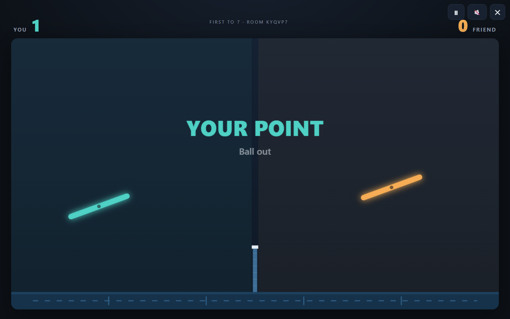

# Line Tennis 🎾

A minimalist multiplayer arcade tennis game. Your racket is a glowing line that
follows your mouse, trackpad, or finger. Tilt it, swing it, and return the ball
past your opponent. **First to 7 wins.**



## Features

- **Real online multiplayer** — private rooms with shareable invitation links
  (`/join/CODE`), authoritative WebSocket server, 60 Hz physics / 30 Hz state
  sync, reconnect-after-reload, disconnect grace period, and forfeit handling.
- **Bot opponent** — Easy / Medium / Hard with human-like reaction delays,
  limited movement speed, aim error, and a small chance to misjudge a shot.
- **Physics** — gravity, air drag, ground bounce with double-bounce rule, net
  collisions (including tape clips), angle-dependent racket reflection with
  swing momentum, and sub-stepped collision detection (no tunneling).
- **Full match flow** — countdown before every serve, point banners with
  reasons, prominent scoreboard, pause/resume (synced online), victory/defeat
  screen, and rematch (unanimous vote online).
- **Polish** — particles, ball trail, camera shake, boundary/net flash rings,
  procedural WebAudio sound effects (no audio files), responsive desktop +
  mobile layout, mirrored view so your racket is always on the left.

## Controls

| Action | Desktop | Mobile |
|---|---|---|
| Move racket | Move mouse / trackpad | Drag one finger |
| Tilt racket | Mouse wheel or `A` / `D` (arrows too) | Second finger: the line between your two fingers sets the angle |
| Pause | `Esc` or ⏸ button | ⏸ button |

The racket's **angle** determines the reflection direction; **swinging** (moving
the racket fast at contact) adds power; contact near the racket tip adds lift.

## Rules

- First to **7 points**.
- You score when the opponent lets the ball bounce twice on their side, hits it
  into the net so it falls back on their own side, or sends it out of bounds.
- The loser of a point serves next. A short countdown precedes every serve.

## Run it

Requires Node.js ≥ 18. The only dependency is `ws`.

```bash
npm install
npm start          # http://localhost:3000
```

Custom port: `PORT=8080 npm start` (PowerShell: `$env:PORT=8080; npm start`).

### Play across devices on your LAN

The server listens on `0.0.0.0`. Find your machine's LAN IP (e.g.
`192.168.1.20`) and open `http://192.168.1.20:3000` on both devices. Create a
room on one device — the invitation link automatically uses the host you
opened, so the copied link works on the other device as-is. Allow port 3000
through your firewall if prompted.

### Deploy publicly (any Node host)

See **[DEPLOY.md](DEPLOY.md)** for two verified routes: an instant
Cloudflare quick tunnel (no account) and permanent hosting on Render/Railway
with the bundled `render.yaml` / `railway.json` configs.

The app is a single always-on Node process (HTTP + WebSocket on one port), so
it deploys unchanged to Render, Railway, Fly.io, a VPS, etc.:

- **Build command:** `npm install`
- **Start command:** `npm start`
- The platform provides `PORT`; HTTPS/WSS is handled by the platform's proxy —
  the client automatically upgrades to `wss:` on HTTPS pages.
- Rooms live in memory; a single instance is all you need. (For multi-instance
  scaling you would add sticky sessions or a shared room store.)

Example (Render): push this folder to a Git repo → New Web Service → Node
environment → build `npm install`, start `npm start` → done. Invitation links
then work worldwide across any devices and browsers.

## Architecture

```
src/
  game-core.js   Pure deterministic simulation (court, physics, scoring).
                 Shared verbatim by server and browser — one source of truth.
  server.js      HTTP static server + WebSocket room manager. Authoritative:
                 runs the sim at 60 Hz, broadcasts snapshots at 30 Hz,
                 validates/clamps all input to each player's own half.
public/
  index.html     Screens: menu, lobby, bot setup, game, overlays.
  css/style.css  Minimalist arcade theme, responsive layout.
  js/
    main.js      Controller: screens, modes, loop, HUD, overlays.
    renderer.js  Canvas drawing: court, rackets, ball, particles, banners.
    input.js     Pointer/touch/keyboard input → racket targets.
    bot.js       Predictive AI with difficulty-scaled human limitations.
    net.js       WebSocket client: rooms, reconnect tokens, input streaming.
    audio.js     Procedural WebAudio sound effects.
    game-core.js Node-only re-export shim (browsers get src/game-core.js
                 served at this path; kept so tests can import bot.js).
test/
  sim-test.js    Headless physics/scoring/bot tests (node test/sim-test.js).
  net-test.js    Live-server protocol tests: two real WS clients verify
                 create/join, sync, pause, disconnect, reconnect, forfeit,
                 rematch voting (node test/net-test.js).
```

### Networking protocol (JSON over `/ws`)

Client → server: `create`, `join {code, token?}`, `input {x,y,a}`, `pause`,
`rematch`, `leave`, `ping`.
Server → client: `created`, `joined`, `begin`, `state` (30 Hz snapshot),
`ev` (hit/bounce/net/point/serve/forfeit/matchover), `paused`, `opponent`,
`rematchVote`, `rematchGo`, `error`, `pong`.

- The **server owns the ball**. Clients only send racket targets; the server
  clamps them to the sender's half, so neither player can cheat.
- Each player receives a secret reconnect token; reloading the page reclaims
  the same slot and match state (stored in `sessionStorage`).
- If a player drops, the match auto-pauses for a 20 s grace period, then the
  remaining player wins by forfeit. Empty rooms expire after 10 minutes.
- The guest's view is mirrored so both players always play on the left.

### Testing

```bash
npm test           # runs both suites
```

The suites cover physics edge cases (double bounce, net dribble, out balls),
full bot matches at every difficulty, difficulty ordering, and the complete
online protocol including disconnect/reconnect/forfeit/rematch. The game was
also played end-to-end in a real browser (bot match to 7, two-context online
match with invite link, pause sync, reload reconnect, mobile touch controls).

`LT_DEBUG=1` enables a test-only `debug` WebSocket message used by QA to force
match end; it is **off by default** and should stay off in production.